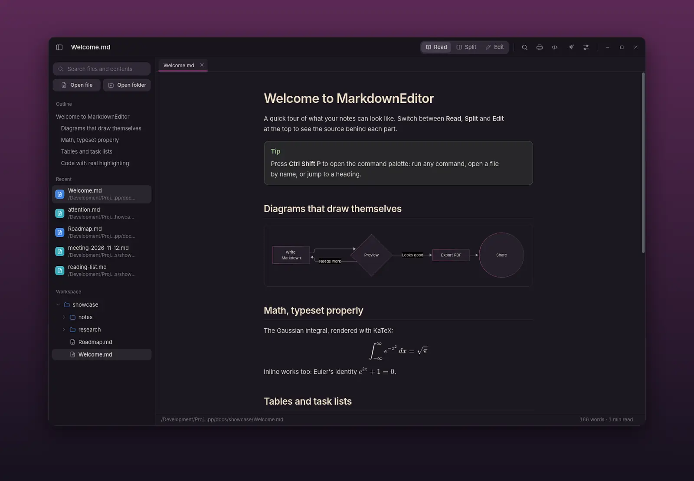
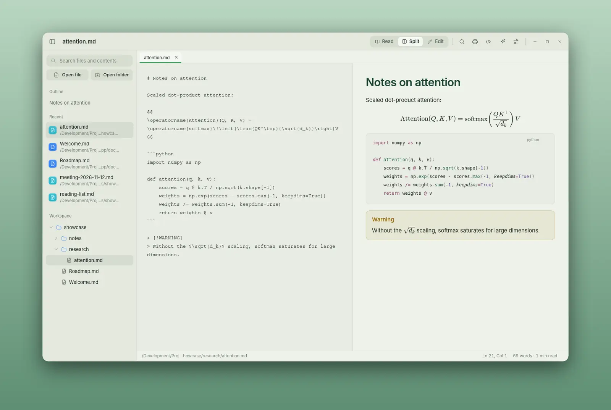
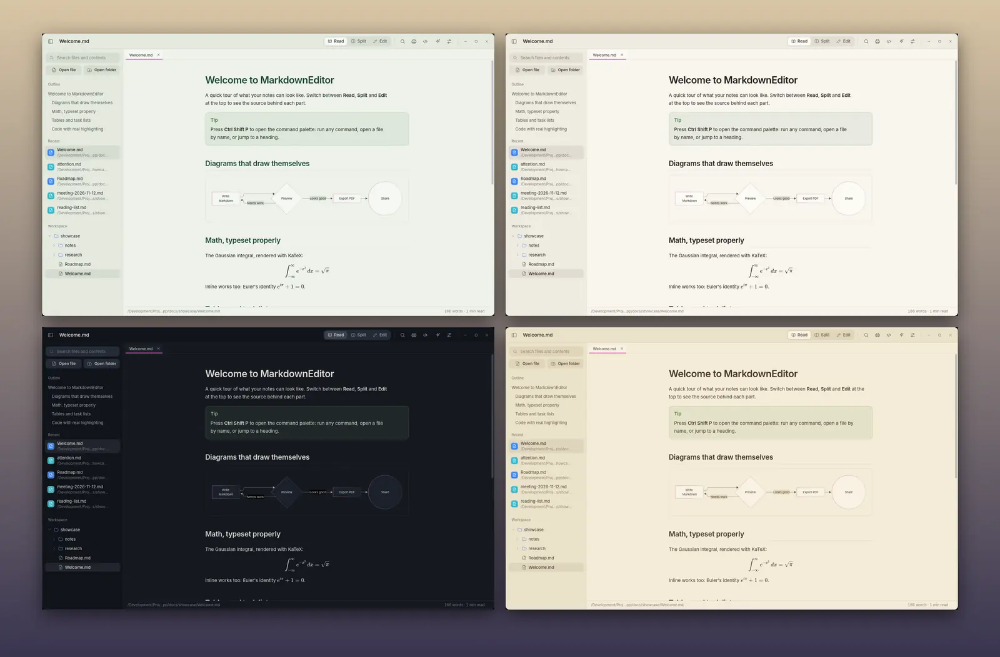
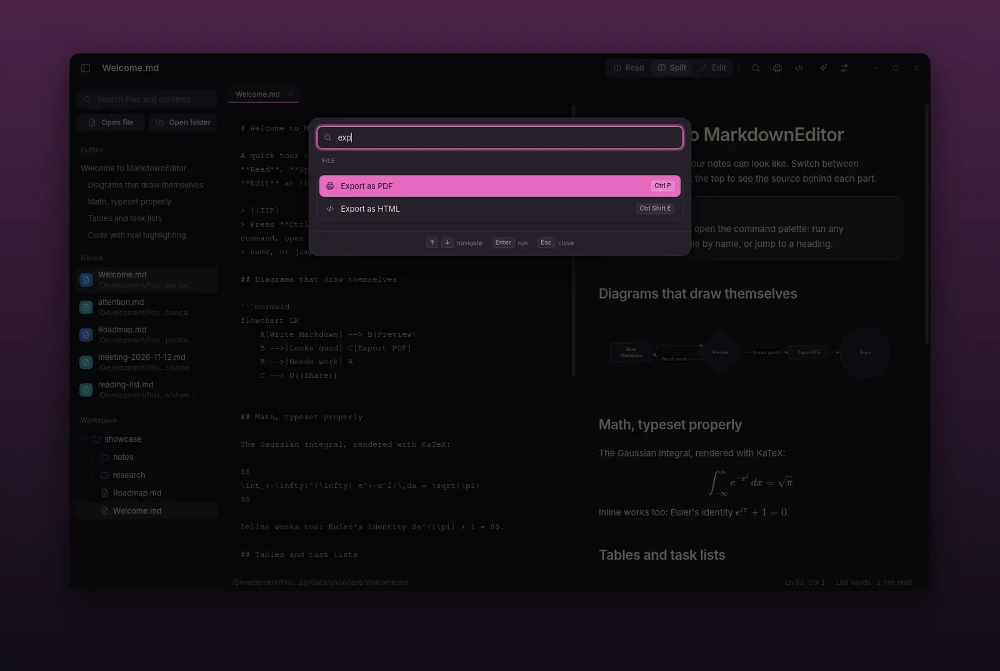
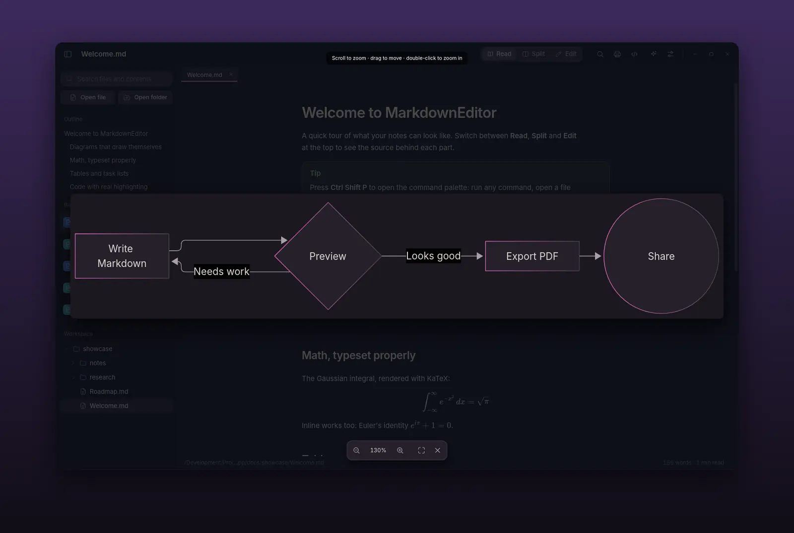
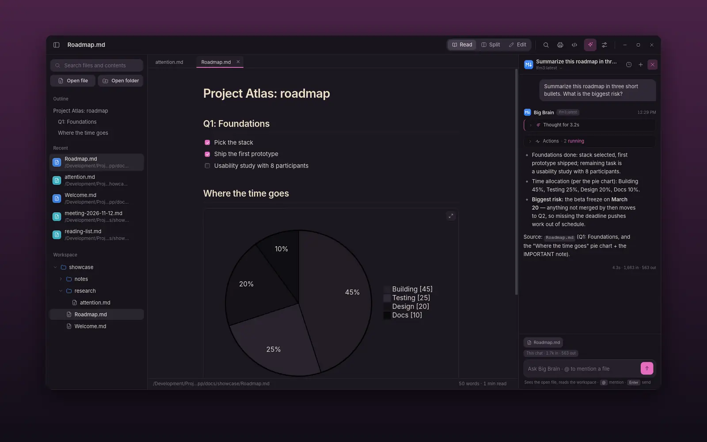

<div align="center">


# MarkdownEditor

**A beautiful, native Markdown reader and editor, with a private AI assistant that runs on your terms.**

Read in calm, book-like themes. Write with a live preview. Diagrams, math and code just render.
About 10 MB, free and open source.

[](https://github.com/MahirHamiAbrar/MarkdownViewer/releases/latest)
[](https://github.com/MahirHamiAbrar/MarkdownViewer/releases)
[](#install)
[](LICENSE)

[](https://github.com/MahirHamiAbrar/MarkdownViewer/releases/latest)
[](https://github.com/MahirHamiAbrar/MarkdownViewer/releases/latest)
[](https://github.com/MahirHamiAbrar/MarkdownViewer/releases/latest)

<br />



</div>

## Why MarkdownEditor?

**⚡ Native and tiny.** Built with Rust and Tauri, not Electron. The installer is about 10 MB, it
starts fast, and the preview keeps up while you type.

**📖 Made for reading.** Twelve themes tuned for long reading sessions (Sage, Plum, Paper,
Midnight, Sepia, E-ink and more), your choice of fonts, reading width and line spacing.

**✍️ Powerful when you write.** Split view with scroll sync, Mermaid diagrams, KaTeX math,
syntax highlighting for ~200 languages, regex find & replace, and a command palette for everything.

**🔒 AI on your terms.** Big Brain reads your document and answers questions about it. Bring your
own model (OpenAI, Anthropic, DeepSeek, OpenRouter) or run one locally with Ollama so nothing
leaves your computer. Keys stay in your OS keychain; web search goes through Tor.

## A quick tour

<table>
  <tr>
    <td width="50%">
      
      <p align="center"><b>Split view.</b> Source and live preview side by side, scrolling together.</p>
    </td>
    <td width="50%">
      
      <p align="center"><b>Themes for every light.</b> Sage, Paper, Midnight, Sepia and eight more.</p>
    </td>
  </tr>
  <tr>
    <td width="50%">
      
      <p align="center"><b>Command palette.</b> <kbd>Ctrl</kbd> <kbd>Shift</kbd> <kbd>P</kbd> runs commands, opens files, jumps to headings.</p>
    </td>
    <td width="50%">
      
      <p align="center"><b>Zoom into diagrams.</b> Click any image or diagram to pan and zoom.</p>
    </td>
  </tr>
  <tr>
    <td colspan="2">
      
      <p align="center"><b>Big Brain, running locally.</b> Ask about the open document; here a local Ollama model summarizes a roadmap, and nothing leaves the machine.</p>
    </td>
  </tr>
</table>

Want to try these yourself? Clone the repo and run `mde docs/showcase` to open the demo folder
shown above.

## Install

**Linux and macOS**

```sh
curl -fsSL https://raw.githubusercontent.com/MahirHamiAbrar/MarkdownViewer/main/scripts/install.sh | sh
```

**Windows (PowerShell)**

```powershell
irm https://raw.githubusercontent.com/MahirHamiAbrar/MarkdownViewer/main/scripts/install.ps1 | iex
```

The installers fetch the latest release and verify its checksum. Prefer a package? Grab the
`.deb`, `.AppImage`, `.dmg`, `.exe` or `.msi` from the
[Releases page](https://github.com/MahirHamiAbrar/MarkdownViewer/releases/latest). The app
updates itself in the background.

> [!NOTE]
> The macOS and Windows builds are not code-signed yet. On macOS, right-click the app and choose
> **Open** the first time; on Windows, choose **More info → Run anyway**.

Signature verification, manual install steps and building from source:
[docs/INSTALL.md](docs/INSTALL.md).

## Everything it does

<details>
<summary><b>Reading & writing</b></summary>

- Three view modes: **Read**, **Split** (source + live preview with scroll sync), and **Edit**
- GitHub-flavored Markdown: tables, task lists, strikethrough, autolinks, footnotes, alerts
  (NOTE/TIP/IMPORTANT/WARNING/CAUTION), heading anchors, and YAML front matter
- Mermaid diagrams and KaTeX math (`$inline$`, `$$display$$`, ```` ```math ````) render live
- Syntax highlighting for ~200 languages
- Click an image or diagram to expand it: drag to move, scroll or pinch to zoom
- Find & replace with match case, whole word, and regular expressions
- Smart editing: Enter continues lists and quotes, Tab indents, typing `*`, `_`, `` ` `` or a
  bracket wraps the selection, <kbd>Ctrl</kbd> <kbd>B</kbd> / <kbd>I</kbd> / <kbd>K</kbd> for bold, italic and links
- Syntax-colored editor, auto-closed brackets and code fences, and suggestions as you type:
  `/` blocks, code languages, files and headings to link to, and words from the document
- Tick a task-list checkbox in the preview and the source updates
- Word count, cursor position, and undo/redo history

</details>

<details>
<summary><b>Files & workspaces</b></summary>

- Tabs, restored after a restart, and workspaces holding any number of folders plus loose files
- Folder tree of all Markdown files (`.md`, `.markdown`, `.mdx`)
- Search across file names *and* file contents
- Document outline; click a heading to jump to it
- Command palette (<kbd>Ctrl</kbd> <kbd>Shift</kbd> <kbd>P</kbd>) for commands, files and headings
- Files changed on disk reload when you return to the window (unsaved edits are kept)
- Atomic saves, and unsaved text is recovered after a crash
- Export to PDF (<kbd>Ctrl</kbd> <kbd>P</kbd>) or a self-contained HTML page (<kbd>Ctrl</kbd> <kbd>Shift</kbd> <kbd>E</kbd>)
- Built-in PDF and HTML viewer
- Opens as the default app for Markdown files; drag and drop works too

</details>

<details>
<summary><b>Look & feel</b></summary>

- Frameless, translucent window with custom chrome
- Themes: Sage and Plum (default, following the system), Paper, Midnight, Sepia, Dusk, E-ink,
  Forest, Light, Dark, Monokai and Vercel, plus an accent color picker
- Frosted-glass popups and menus (**Settings → Turn on Blur Effect**): on by default on macOS
  and Windows, off on Linux, where WebKitGTK usually cannot draw the blur ([why](docs/BLUR.md))
- Interface, document and editor fonts from those installed on your system
- Reading width, line spacing, justified text, code wrapping, tab width, autosave and startup behavior

</details>

<details>
<summary><b>Big Brain (AI)</b></summary>

- Always sees the open document, including unsaved edits; select text to **Ask Big Brain** about it
- DeepSeek, OpenAI, Anthropic, OpenRouter, a local Ollama, or any OpenAI- or Anthropic-compatible endpoint
- Streaming answers with an expandable **Thinking** disclosure and an **Actions** trace
- Private web search through Google, Bing, DuckDuckGo, Mojeek or SearXNG, routed through a proxy or Tor
- Reads large documents by outline, and can search the other Markdown files in your folder
- Per-message token usage and cost; chats are saved and can be renamed or deleted
- **About you** notes and a **Memory** of lasting preferences personalize every chat

Nothing is configured out of the box. Add a provider in **Settings → Big Brain → Add model
provider**. Your document is sent only when you ask a question, and with Ollama it never leaves
your computer. Full guide: [docs/BIG_BRAIN.md](docs/BIG_BRAIN.md).

</details>

## From the terminal

```sh
mde notes.md        # open a file (in the window used last, if the app is running)
mde notes.md:42     # ... at line 42
mde docs/           # open a folder in a new window
mde -n notes.md     # force a new window
mde -a docs/        # add the folder to the window used last
EDITOR="mde --wait" git commit   # use it as your git editor
```

`mde` is the short form of `markdowneditor`. A path that does not exist yet opens as a new
document and is created on first save. `mde --help` lists every option.

## Contributing

Bug reports, ideas and pull requests are welcome. See [CONTRIBUTING.md](CONTRIBUTING.md),
[docs/BUILDING.md](docs/BUILDING.md) for the development setup and architecture, and
[CHANGELOG.md](CHANGELOG.md) for what changed.

If MarkdownEditor makes your notes nicer to live with, a ⭐ helps others find it.

<sub>MIT licensed. Built with [Tauri](https://tauri.app), [comrak](https://github.com/kivikakk/comrak),
[Mermaid](https://mermaid.js.org), [KaTeX](https://katex.org) and [pdf.js](https://mozilla.github.io/pdf.js/).</sub>
