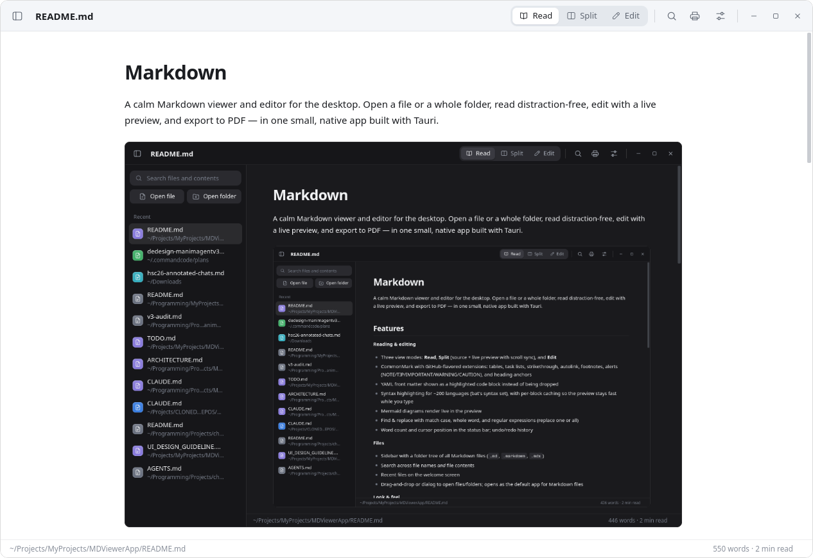

# Markdown

A calm Markdown viewer and editor for the desktop. Open a file or a whole folder, read
distraction-free, edit with a live preview, and export to PDF — in one small, native app
built with Tauri.



## Features

**Reading & editing**
- Three view modes: **Read**, **Split** (source + live preview with scroll sync), and **Edit**
- CommonMark with GitHub-flavored extensions: tables, task lists, strikethrough, autolink,
  footnotes, alerts (NOTE/TIP/IMPORTANT/WARNING/CAUTION), and heading anchors
- YAML front matter shown as a highlighted code block instead of being dropped
- Syntax highlighting for ~200 languages (bat's syntax set), with per-block caching so the
  preview stays fast while you type
- Mermaid diagrams render live in the preview
- Find & replace with match case, whole word, and regular expressions (replace one or all)
- Word count and cursor position in the status bar; undo/redo history

**Files**
- Sidebar with a folder tree of all Markdown files (`.md`, `.markdown`, `.mdx`)
- Search across file names *and* file contents
- Recent files on the welcome screen
- Drag-and-drop or dialog to open files/folders; opens as the default app for Markdown files

**Look & feel**
- Frameless, translucent window with custom chrome (minimize / maximize / close)
- Light and dark themes, with an accent color picker
- Configurable interface, document, and editor fonts (picks up the fonts installed on your system)
- Export the current document to PDF

**Mark (AI)**
- Right-side assistant that always sees the open document, including unsaved edits
- Select any text to reveal **Ask Mark**; the selection is attached alongside the full file
- Streaming Markdown answers with an expandable **Thinking** disclosure and an **Actions** trace
- Private web search through Google, Bing, DuckDuckGo, Mojeek or SearXNG, with retries, proxy/Tor routing and provider fallback
- Per-message token usage, plus chat totals and cost when the gateway reports it
- Chats are saved under `~/.markdown-viewer-app/chats`, named by the model, and can be renamed or deleted

## Mark (AI)

Mark answers through the [Command Code gateway](https://commandcode.ai/docs/provider) using
**DeepSeek V4.1 Flash** with selectable reasoning effort (Off / Low / High / Max; default High).

Set `CMD_API_KEY` in `.env` for development, or paste a key in **Settings → Mark** (stored in
`~/.markdown-viewer-app/config.json`, mode 0600). The app never exposes the key to the webview:
requests go through the Rust backend, and the document text is sent to Command Code only when you
ask Mark a question.

Chats persist as JSON at `~/.markdown-viewer-app/chats/<date>/<id>.json`, including messages,
reasoning, actions, and token/cost usage. Nothing is sent anywhere else, and stored reasoning is
never replayed to the model.

### Private web search

Mark can call a `web_search` tool when an answer needs current information. Toggle it from the
model menu in Mark's header. Searches are **proxy-only by default**: without an explicit proxy,
Mark tries Tor at `socks5h://127.0.0.1:9050`; if Tor is not running, search fails instead of
falling back to your real IP. Direct search is opt-in from **Settings → Mark** and is clearly
marked as non-private.

Providers are tried in order, with retries and proxy/user-agent rotation. CAPTCHA, consent and
JS-challenge pages are detected and skipped. Search queries and snippets are sent to
Command Code as part of the model request; the search engine only sees the proxy/Tor route.

Search settings live in `~/.markdown-viewer-app/config.json`:

```json
{
  "search": {
    "enabled": true,
    "providers": ["google", "bing", "duckduckgo", "mojeek", "searx"],
    "searxUrl": "http://127.0.0.1:8080",
    "proxy": "socks5h://127.0.0.1:9050",
    "proxies": [],
    "allowDirect": false,
    "useTor": true,
    "retries": 1,
    "maxResults": 5,
    "timeoutMs": 8000,
    "totalTimeoutMs": 30000
  }
}
```

- `proxy` / `proxies` — HTTP(S) or SOCKS proxies; multiple proxies rotate between retries.
  Prefer `socks5h://` so DNS is resolved by the proxy/Tor, not locally.
- `allowDirect` — when no proxy is configured, use a direct connection (reveals your IP).
- `useTor` — fall back to `socks5h://127.0.0.1:9050` when no proxy is configured and direct is off.
- `providers` — any order of `google`, `bing`, `duckduckgo`, `mojeek`, `searx`.
  `searx` requires `searxUrl`; a self-hosted instance is the most reliable private option.
- `retries` — extra attempts per provider (capped at 3); each retry rotates the proxy and user agent.

## Download & install (Linux)

Every `v*` tag is built by the [CI pipeline](.gitlab-ci.yml) and published on the
[Releases page](../../releases) — download a package and install it directly, no build required:

- **`Markdown_<version>_amd64.deb`** — Debian, Ubuntu, and derivatives
- **`Markdown_<version>_amd64.AppImage`** — any other distribution with a desktop

```sh
# Debian / Ubuntu: installs the app and pulls in its system dependencies
sudo apt install ./Markdown_<version>_amd64.deb

# AppImage: no installation, just make it executable and run it
chmod +x Markdown_<version>_amd64.AppImage
./Markdown_<version>_amd64.AppImage
```

Both come with a desktop entry and Markdown file associations.

### Build from source

```sh
./install.sh
```

Builds the release binary and installs it for the current user (`~/.local`), registers a
desktop entry, and sets it as the default app for Markdown files.

```sh
./install.sh --reinstall   # rebuild and install fresh
./install.sh --uninstall   # remove it
PREFIX=/usr/local sudo -E ./install.sh   # system-wide
```

System libraries (`libwebkit2gtk-4.1-dev`, `libgtk-3-dev`, …) are installed automatically on
apt-based distros. See the [Tauri Linux prerequisites](https://v2.tauri.app/start/prerequisites/#linux)
for other distributions.

## Development

Requires [Rust](https://rustup.rs), Node.js, and the Tauri system dependencies for your platform.

```sh
npm ci          # install the Tauri CLI
npm run dev     # run the app in development mode
npm run build   # release build with installers/bundles
```

Tests and checks:

```sh
cargo test --manifest-path src-tauri/Cargo.toml
node --check src/main.js
```

CI runs the tests on every push and, on a `v*` tag, builds the `.deb` and `.AppImage` and
publishes them on the [Releases page](../../releases).

## Architecture

- `src/` — frontend: plain HTML/CSS/JS (no framework), with Mermaid vendored for diagrams
- `src-tauri/` — Rust backend (Tauri 2): Markdown rendering via
  [comrak](https://github.com/kivikakk/comrak), highlighting via syntect (two-face syntax set),
  HTML sanitization via [ammonia](https://github.com/rust-ammonia/ammonia), plus the Command Code
  gateway proxy (streaming SSE, reasoning, tool calling, usage/cost), private web search
  (Google/Bing/DuckDuckGo/Mojeek/SearXNG through proxy/Tor with retries), chat storage, file tree,
  search, font listing, and PDF printing commands
- `install.sh` — build + Linux desktop integration (desktop file, icons, MIME defaults)
