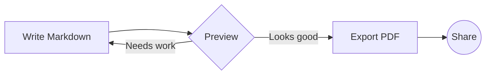

# Welcome to MarkdownEditor

A quick tour of what your notes can look like. Switch between **Read**, **Split** and
**Edit** at the top to see the source behind each part.

> [!TIP]
> Press **Ctrl Shift P** to open the command palette: run any command, open a file by
> name, or jump to a heading.

## Diagrams that draw themselves



## Math, typeset properly

The Gaussian integral, rendered with KaTeX:

$$
\int_{-\infty}^{\infty} e^{-x^2}\,dx = \sqrt{\pi}
$$

Inline works too: Euler's identity $e^{i\pi} + 1 = 0$.

## Tables and task lists

| Feature        | Read | Split | Edit |
| -------------- | :--: | :---: | :--: |
| Live preview   |  ✓   |   ✓   |      |
| Scroll sync    |      |   ✓   |      |
| Find & replace |  ✓   |   ✓   |  ✓   |

- [x] Draft the outline
- [x] Add a diagram
- [ ] Export to PDF and send

## Code with real highlighting

```rust
fn main() {
    let notes = std::fs::read_to_string("Welcome.md").unwrap();
    println!("{} words", notes.split_whitespace().count());
}
```

> [!NOTE]
> Over 200 languages are highlighted, and the preview stays fast while you type.
